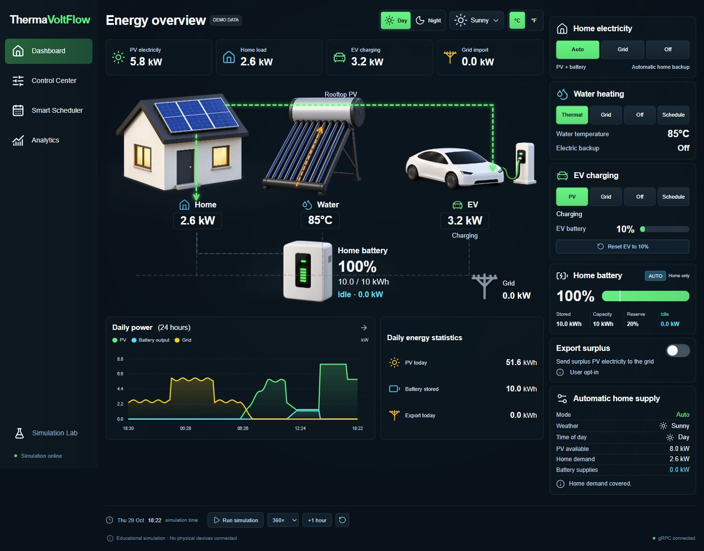
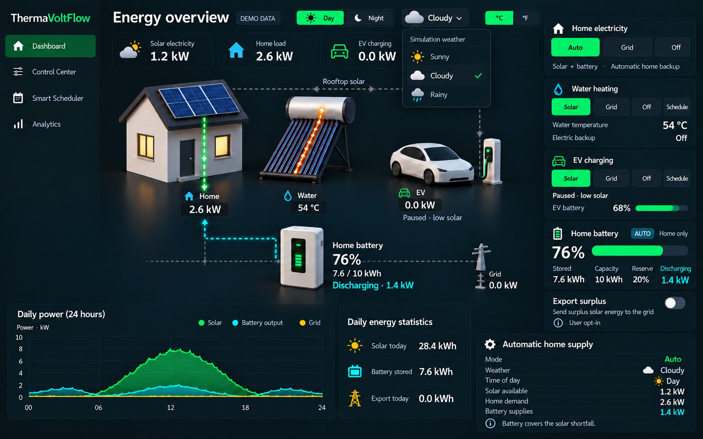
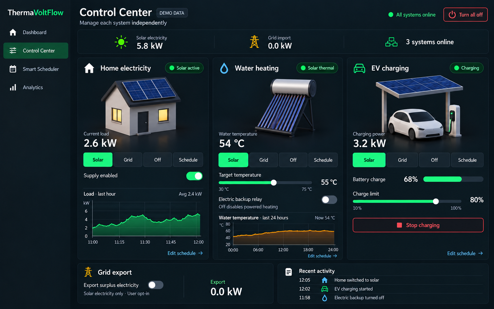
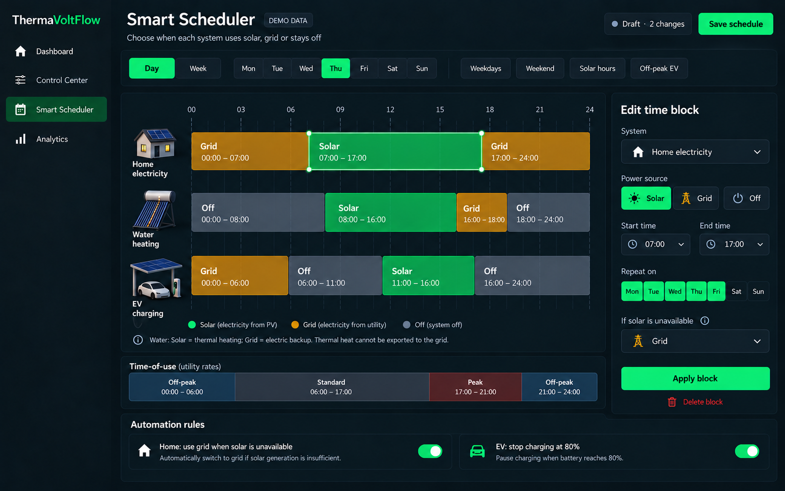
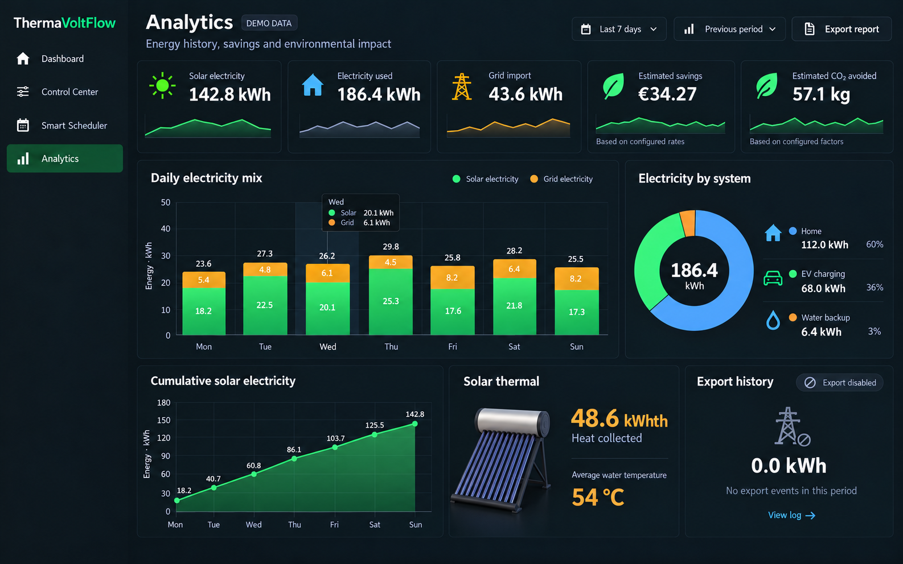

# ThermaVoltFlow

ThermaVoltFlow is an interactive energy dashboard that simulates a home's rooftop photovoltaic (PV) system, home battery, electric vehicle charging, and independent solar water heater. Change the weather, switch between day and night, and compare how each energy source responds through animated flow lines, live readings, schedules, and historical charts.

The project combines a **Laravel/PHP backend** with a **Svelte/TypeScript frontend**, communicating through **gRPC-Web and native gRPC**. It is an educational application with simulated devices and editable data; no physical hardware or live weather service is required.

**Run locally:** this repository contains the complete frontend and backend. There is no hosted website or online demo. [Screenshots and design previews](#screenshots-and-design-previews) are included at the bottom of this page.

## Features

| Page | What you can do |
| --- | --- |
| Dashboard | Follow animated energy flows, inspect PV generation and consumption, view battery charge and water temperature, and change source modes. |
| Control Center | Manage home electricity, EV charging, thermal heating, grid fallback, and optional export of surplus PV electricity. |
| Smart Scheduler | Create recurring EV and water-heating time blocks using PV/thermal, grid, or off modes. |
| Analytics | Explore energy history, estimated savings and avoided CO2, battery activity, and grid import/export; export readings as CSV. |
| Simulation Lab | Adjust capacities, demand, battery percentages, temperature, tariffs, and simulated variation to test different scenarios. |

- Sunny, cloudy, and rainy weather with an independent day/night switch.
- Celsius and Fahrenheit display options.
- Playback at **1x, 60x, 360x, or 1440x**, with faster energy-flow animation at higher speeds.
- Shared simulation playback continues when navigating between application pages.
- Reset the EV to **10%** to repeat charging experiments without resetting the entire demo.
- Seven days of sample history and isolated, database-backed demo sessions.

## Energy model

One rooftop PV installation supplies the **home and EV charger**. The home battery stores surplus PV electricity and automatically covers the home's PV shortfall, subject to its capacity, reserve, and discharge limit. It does not power the EV, water heater, or grid export, and its operation is not scheduled.

Water heating uses a separate **solar thermal collector** with an electric grid backup. EV charging and water heating have their own source controls and schedules. Grid fallback and surplus PV export are opt-in settings. Energy, savings, and carbon figures are simulation estimates.

Weather and day/night are manual simulation conditions. They do not change the simulation clock automatically. Schedules follow that clock; playback advances while the application is open and running, not as an unattended background service.

## Technology and structure

| Layer | Technology | Location |
| --- | --- | --- |
| Interface | Svelte 5, TypeScript, Vite, Inertia | [`web/resources/js`](web/resources/js) |
| Application and simulation | Laravel 13, PHP | [`web/app`](web/app) |
| API contract | Protocol Buffers and gRPC | [`web/proto/energy.proto`](web/proto/energy.proto) |
| Browser API transport | Binary gRPC-Web through a Node gateway | [`web/scripts/gateway.mjs`](web/scripts/gateway.mjs) |
| PHP gRPC server | RoadRunner | [`web/grpc-worker.php`](web/grpc-worker.php) |
| Local persistence | SQLite and Laravel migrations | [`web/database`](web/database) |
| Tests | PHPUnit and Node's test runner | [`web/tests`](web/tests) |
| Visual references | Design concepts and application screenshots | [`design-concepts`](design-concepts) |

The browser connects to `http://127.0.0.1:8000`. The gateway forwards page requests to Laravel on port `8001` and converts `/rpc` requests from gRPC-Web into native HTTP/2 gRPC for RoadRunner on port `9001`. PHP validates changes, calculates the simulation, and persists each demo session.

## Run locally

### Requirements

- PHP **8.4** with the extensions required by Composer, including PDO SQLite.
- Composer **2**.
- Node.js **24** and npm.
- A RoadRunner binary with gRPC support for your operating system; the local project uses **3.0.1**.

Runtime binaries, dependencies, the private `.env` file, the SQLite database, and generated frontend build output are excluded from Git. Install the prerequisites on a fresh clone; the developer's local `.runtime` directory is not included.

### Install

From PowerShell, with `php`, `composer`, and `npm` available on your PATH:

```powershell
git clone https://github.com/mtsmdev/ThermaVoltFlow.git
cd ThermaVoltFlow/web
composer install
npm ci
Copy-Item .env.example .env
php artisan key:generate
php -r "file_exists('database/database.sqlite') || touch('database/database.sqlite');"
php artisan migrate
npm run build
```

In `web/.env`, set `APP_NAME=ThermaVoltFlow` and `APP_URL=http://127.0.0.1:8000`. Keep `DB_CONNECTION=sqlite` for the local demo. The checked-in generated PHP and TypeScript protobuf files are ready to use; code generation is not required to start the application.

### Start

Set the full paths to your installed binaries. Replace the RoadRunner example path with your own:

```powershell
$env:PHP_BINARY = (Get-Command php).Source
$env:RR_BINARY = 'C:\tools\roadrunner\rr.exe'
npm start
```

Open **http://127.0.0.1:8000**. The launcher starts Laravel, RoadRunner, and the gateway together. Keep the terminal running; press `Ctrl+C` to stop them. Ports `8000`, `8001`, and `9001` must be available.

For an existing local setup with the expected `.runtime` binaries already installed, the root [`Start-ThermaVoltFlow.ps1`](Start-ThermaVoltFlow.ps1) script starts the same application. On other operating systems, set `PHP_BINARY` and `RR_BINARY` to the appropriate executables before running `npm start` from `web/`.

### Try a scenario

1. Start playback and select **Sunny + Day** to supply the home and EV from PV.
2. Switch to **Cloudy** or **Night** and observe automatic home battery backup.
3. Reset the EV to **10%**, select PV or Grid charging, and increase playback speed.
4. Add a time block in Smart Scheduler, save it, and select **Schedule** for that device in Control Center.
5. Review the resulting readings and totals in Analytics.

## Validation

Run from `web/`:

```powershell
php vendor/bin/phpunit
npm run check
node --test tests/simulation-runtime.test.mjs
npm run build
```

With the complete application running, use another terminal for the gRPC integration tests:

```powershell
node --test tests/grpc.test.mjs
```

These tests cover simulation rules, request validation, schedule boundaries, session isolation, playback across navigation, and repeated EV charging resets. Integration tests create their own demo sessions.

## Screenshots and design previews

### Application screenshot

The implemented dashboard, including shared rooftop PV, automatic home battery backup, simulation speed controls, and EV reset:



### Original design previews

These images document the visual design process. They are mockups, not captures of the running application. Earlier Control Center and Scheduler concepts show a separate EV canopy and home scheduling; the implemented application instead shares rooftop PV between the home and EV and keeps home battery backup automatic.

#### Dashboard



#### Control Center



#### Smart Scheduler



#### Analytics


